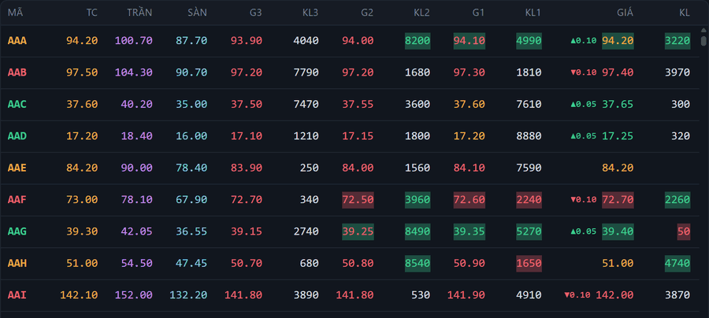
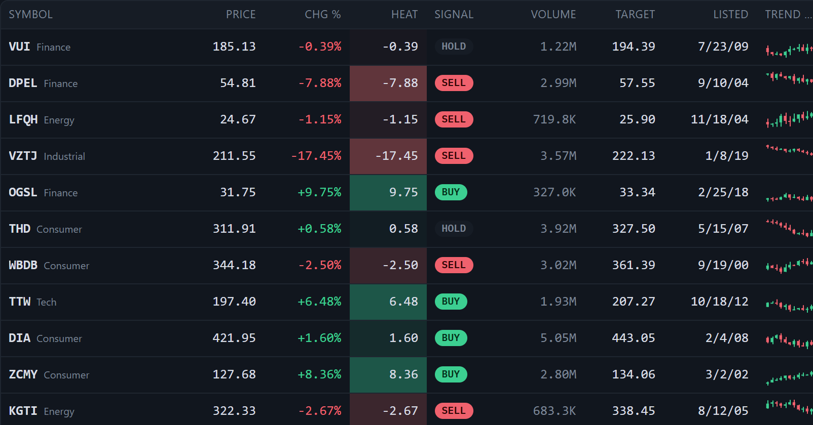
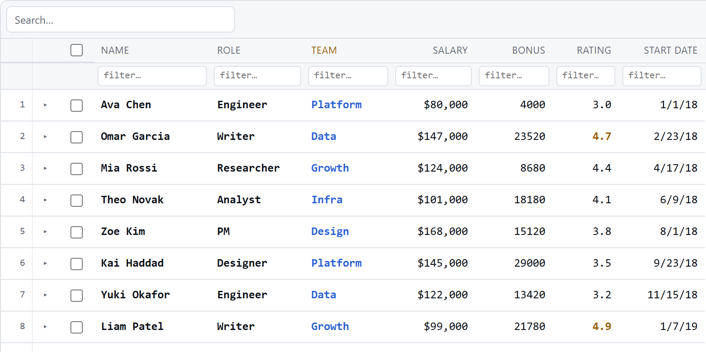

<div align="center">


# bo-grid

**The data grid for busy markets.**

A fast, lightweight Svelte 5 data grid for trading screens, with a custom
element for every other framework.

[](https://www.npmjs.com/package/bo-grid)
[](https://github.com/bonguynvan/bo-grid/actions/workflows/ci.yml)
[](./BENCHMARKS.md)
[](./LICENSE)
[](https://github.com/sponsors/bonguynvan)

**[Docs](https://bonguynvan.github.io/bo-grid/docs/)** ·
**[Examples](https://bonguynvan.github.io/bo-grid/examples/)** ·
**[API reference](https://bonguynvan.github.io/bo-grid/docs/reference/)** ·
**[Benchmarks](./BENCHMARKS.md)** ·
**[Changelog](./CHANGELOG.md)**



</div>

## Why bo-grid

- **Fast under load.** A 1,000-symbol price board at 30,000 ticks a second
  takes about 4.5 ms of main-thread work a frame (about 11 ms at p95), with
  every changed cell flashing. [How it's measured](./BENCHMARKS.md)
- **Built for trading.** Tick flashes, price-limit colours, tick-aware
  formatting, a depth ladder with click-to-trade, and order book and
  time-and-sales helpers.
- **Complete.** Sorting, filtering, grouping, pivot, tree data, editing,
  clipboard and Excel export, all in one MIT package.
- **Small and SSR-safe.** About 46 KB gzip, no runtime dependencies, and clean
  server rendering in SvelteKit.
- **Accessible.** A full keyboard model with grid and treegrid semantics.

<table>
  <tr>
    <td width="50%"></td>
    <td width="50%"></td>
  </tr>
</table>

## Install

```sh
npm i bo-grid
```

Svelte 5 is a peer dependency. Other frameworks can use the `<bo-grid>`
element and need no Svelte setup.

## Quick start

```svelte
<script lang="ts">
  import { Grid, type ColumnDef } from 'bo-grid';

  const columns: ColumnDef[] = [
    { type: 'text',    key: 'symbol', header: 'Symbol' },
    { type: 'price',   key: 'price',  header: 'Price', flash: 'auto' },
    { type: 'percent', key: 'change', header: 'Chg %' },
    { type: 'volume',  key: 'volume', header: 'Volume' },
  ];

  let rows = $state([{ id: 1, symbol: 'AAPL', price: 189.3, change: 1.24, volume: 51_200_000 }]);
</script>

<Grid {rows} {columns} height={480} />
```

React or Vue:

```tsx
import { BoGrid } from 'bo-grid/react'; // or 'bo-grid/vue'

<BoGrid rows={rows} columns={columns} height={480} />
```

Angular or plain JS:

```js
import { createBoGrid } from 'bo-grid/element';

document.querySelector('#board')?.append(createBoGrid({ columns, rows, height: 480 }));
```

## Documentation

| | |
| --- | --- |
| [Docs](https://bonguynvan.github.io/bo-grid/docs/) | A page per feature with live examples and their code, including [live updates](https://bonguynvan.github.io/bo-grid/docs/realtime/) for busy boards |
| [Examples](https://bonguynvan.github.io/bo-grid/examples/) | Every example running, each with its source |
| [Props reference](https://bonguynvan.github.io/bo-grid/docs/reference/) | Every prop, column option and API method, generated from the types; [all exports](https://bonguynvan.github.io/bo-grid/api.html) |
| [Guide](./docs/guide.md) | The whole guide in one file |
| [Frameworks](./docs/frameworks.md) | The React and Vue components, the Angular recipe; build-free starters in [examples/](./examples/) |
| [SvelteKit](./docs/sveltekit.md) | Loading data, SSR, lazy loading and saved layouts |
| [Benchmarks](./BENCHMARKS.md) | Bundle size and frame costs, and how to reproduce them |
| [Accessibility](./ACCESSIBILITY.md) | Roles, keyboard model and contrast |
| [For AI agents](https://bonguynvan.github.io/bo-grid/docs/ai/) | [llms.txt](https://bonguynvan.github.io/bo-grid/llms.txt), every docs page as Markdown, [api.json](https://bonguynvan.github.io/bo-grid/api.json) and editor rules in [docs/ai](./docs/ai) |

## Contributing

Issues and pull requests are welcome. See [CONTRIBUTING.md](./CONTRIBUTING.md)
for setup and checks, the [code of conduct](./CODE_OF_CONDUCT.md), and
[SECURITY.md](./SECURITY.md) for reporting vulnerabilities.

[](https://pkg.pr.new/~/bonguynvan/bo-grid)

Every pull request and every commit on `main` is published as a preview
package. A bot comment on the pull request gives the install command, for
example:

```sh
npm i https://pkg.pr.new/bo-grid@123        # pull request #123
npm i https://pkg.pr.new/bo-grid@a1b2c3d    # a commit
```

Previews are for testing only. Use the npm release in production.

## Related

**[TradeCanvas](https://github.com/bonguynvan/tradecanvas)**: canvas trading
charts with indicators, drawing tools and live streaming. Pair it with bo-grid
for a full trading desk.

## Sponsor

If bo-grid saves you time, you can support its development on
[GitHub Sponsors](https://github.com/sponsors/bonguynvan).

## License

[MIT](./LICENSE)
